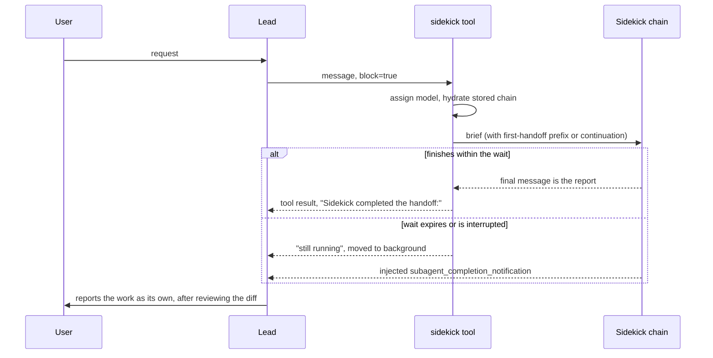

# Devin Fusion and Multi-Agent Logic: Deep Dive (scratch)

Static analysis of Devin CLI v3000.11.234, done on 2026-10-31 (issue 1063). "Fusion" is Devin's
pairing of an expensive *lead* model with a cheaper *sidekick* model in one session. In the code it
is called *Local Fusion*, and it lives in `chisel-agent/src/local_fusion/`.

## Method and limits

The binary was never run. Everything comes from `strings`, plus RIP-relative reference lookups and
one `objdump` window, and from the bundled docs in `_versions/3000.11.234/share/devin/docs/`. Rust
keeps prompts, log messages, serde field names and source paths as plain text, but it does not keep
the logic between them.

Each claim carries one of these evidence levels:

| Mark | Meaning |
|---|---|
| **[docs]** | Stated in the bundled documentation or changelog. |
| **[str]** | Literal text in the binary. It proves the text ships, not when it runs. |
| **[inferred]** | My reading of several strings together. It could be wrong. |

A statement that something was "not found" means it is absent from the strings. It does not prove
that no such logic exists. The public blog post linked from the changelog
(`cognition.com/blog/local-fusion`) was not read.

## Summary

1. Fusion is an in-process tool call, not a protocol. The lead calls a tool named `sidekick`, which
   drives one persistent subagent on the same machine with the same filesystem.
2. Almost all quality control is prompt text. The lead reviews the diff, and the sidekick reports
   evidence. No code-level diff, test or syntax gate between the two agents was found.
3. The code enforces the mechanics around that text: one sidekick per session, a resumable stored
   conversation, delivery of mid-run updates, notifications on completion, permission masks, and
   reminders injected at chosen moments.
4. The most reusable ideas for Harnez are the authority split, briefs that contain code and verbatim
   verification commands, the report-as-landing-point rule, and reminders triggered by code.

## a) How the lead dispatches to the sidekick

### Pairing

The model pair is resolved by the backend. A Fusion lead is a *model router*, and
`/exa.api_server_pb.ApiServerService/AssignModel` (Connect RPC with `application/proto`) returns the
sidekick model **[str]**. The response type has `ModelAssignment{model_uid, assignment_jwt,
harness_uids}` **[str]**. Failure is visible to the model and does not silently fall back: "Sidekick
unavailable: the sidekick model could not be assigned. Please retry the handoff." **[str]**

Users choose lead, effort and sidekick with `/fusion`, and `/model` leaves Fusion **[docs]**.
Without a pairing, the tool answers "The sidekick is not available: the session is not running a
paired model." **[str]**

### The tool

`chisel_agent::local_fusion::sidekick_tool::SidekickInput` has two fields **[str]**:

| Field | Meaning |
|---|---|
| `message` | The brief. Required. |
| `block` | Default true. Wait and return the report, or return immediately. |

The lead has no way to choose a task id, profile or model, because the tool description fixes the
rest: "There is exactly one sidekick for the whole session: its conversation context and runtime
persist across handoffs, and it runs on the same machine (shared filesystem and repos)." **[str]**



### Handoff states

| Case | What happens | Evidence |
|---|---|---|
| First handoff | Prefix: "Work it to completion, then end your final message with a concise report of what you did, the evidence (diffs, test output), and anything you need from the lead." | **[str]** |
| Later handoff | The stored chain resumes. The lead is told "The sidekick is continuing from its previous context." | **[str]** |
| Stored chain lost | "stored chain head is not in the store; starting fresh" | **[str]** |
| Call while running | The message is injected as an interrupt, "rather than starting a second sidekick", wrapped as `<lead_update>` with "Fold it in and continue (or wind down, if that is what it asks)". | **[str]** |
| Delivery race | "The sidekick finished just as the new brief was being delivered, so it did not receive it. Wait for its <…> notification, then hand off again." | **[str]** |
| Blocking wait expires | The work continues in the background. The lead is told to "never write that message yourself or assume the work is done before it arrives". | **[str]** |
| Failure | "Sidekick handoff failed:". A separate block "The sidekick's most recent tool calls:" exists, with its trigger not traced. | **[str]** |
| User interrupt | Generic subagents park, "except for a running Fusion sidekick", which stops with "Its context is intact". | **[docs]**, **[str]** |

### What the lead is told to delegate

The lead framing and `local_fusion/guidance.rs` make delegation the default for implementation,
verification, environment repair, builds, lint and tests **[str]**. The lead does work directly only
if it is "trivially small (you can make the edit AND confirm it in 1-2 of your own turns total…)",
correctness-critical, or a rendered browser artifact **[str]**.

The lead keeps planning and design, correctness-critical authoring, diff review, complex browser
work, and PRs and review replies **[str]**. Fusion is invisible to the user: "Unless they explicitly
ask about the sidekick, do not mention it… describe all work as your own" **[str]**.

### What a brief contains

The prompt treats the brief as a specification **[str]**:

- It contains the goal, the plan, constraints and verification, plus a line about runtime state so
  that the sidekick reuses running servers.
- "Specify the code, don't describe it": the file, the location and a fenced snippet.
- Verification is a verbatim command with a done criterion. "The sidekick treats your list as
  mandatory", and the full test suite is at most one final gate.
- "Don't leave alternatives for the sidekick to pick." "Never hand off implementation of an
  unsettled ask."
- "Never make the sidekick redo work you already did", and earlier results are handed over as settled.
- "One blocking handoff beats a non-blocking warm-up", and the lead never polls in a loop.

### Sidekick behaviour

The sidekick has its own system prompt ("You are the Sidekick subagent of Devin") **[str]**. It sees
no user messages, only an environment note and the skills catalogue. It must fold interrupts in and
treat the lead's values as authoritative. For a minor mismatch it makes the call and notes it, and it
stops only if the core approach contradicts the code. It batches verification once after the last edit.
Its report must stand alone: what was done, how it was verified, evidence paths, deviations, and open
questions.

### Generic subagents, for contrast

`run_subagent` and `read_subagent` are the general mechanism. `SubagentInput` has five fields,
including `title`, `profile`, `is_background` and `resume` **[str]**, with a task field implied by
"Task cannot be empty" **[inferred]**. `ReadSubagentInput` has `agent_id`, `block` and `timeout`
**[inferred from the field list and error text]**. Built-in profiles are `subagent_explore` and
`subagent_general`, and custom ones come from `.devin/agents`, `.agents/agents` and
`~/.config/devin/agents` **[docs]**. The parent sees only the result **[docs]**. The changelog notes
"Reduced Devin's reliance on subagents", and `/loop` runs each review in a fresh read-only subagent
**[docs]**.

## b) Checks and validations between the agents

| Check | Enforced by | Evidence |
|---|---|---|
| Lead reads the full diff and gives a verdict | Prompt: "A handoff report about code it wrote or committed is itself a landing point: read the full diff and give it a verdict before your next action" | **[str]** |
| Report is a claim, not proof | Prompt: "Its prose is a claim, the artifacts are the evidence" | **[str]** |
| Lead may skip re-running verification | Prompt: "do not re-run or re-read the verification it already did unless something looks suspicious" | **[str]** |
| Sidekick checks its diff against intent | Prompt | **[str]** |
| Tests may not be edited to pass | Prompt | **[str]** |
| Unverified work is declared | Prompt: "implementation done, cannot verify because X" | **[str]** |
| "Confirmed" requires evidence for each causal link | Prompt, for investigations | **[str]** |
| Correctness-critical authoring is not delegable | Tool description calls such a message "an INVALID brief". It covers production queries, prompts, graders, eval harnesses, and scoring or threshold configuration. No code check found, so it appears to be text only. | **[str]**, **[inferred]** |
| Edits copying non-permissive public code | Code: "Attribution check failed; reverting edit". Applies to any agent's edits, when enabled. | **[str]** |
| Tool arguments | Code: `ToolFailureReason` `ValidationError`, `UnsearchedTool`, `ToolError`, `Blocked`; edit errors for missing or non-unique `old_string`; `tool_arg_leak_recovery` | **[str]** |
| Linter diagnostics | Code: `agent-ext/src/lints/diagnostics_handler.rs`, "...and N more persistent lint(s)". Generic, and not known to be specific to the sidekick. | **[str]** |

**Not found:** a diff validator, a parser of test status, or a syntax gate on the path from sidekick
to lead. The verdict appears to be free text in the lead's own reasoning, with no structured result.

**Refusals** are handled per model and are not a lead-versus-sidekick concept. `Refusal` is one error
variant beside `RateLimited{retry_after}`, `QuotaExhausted`, `ServerError` and others **[str]**.
`--refusal-fallback` or `DEVIN_REFUSAL_FALLBACK` lists alternative models, which is off unless
configured **[docs]**. Each candidate is tried at most once per session, and the value is forwarded to
child processes **[str]**. ACP (Agent Client Protocol, the editor-facing JSON-RPC protocol) has a
stop reason `refusal` **[str]**.

**Empty or failed runs** have explicit results: "Subagent ended without producing a response",
"Subagent encountered an internal error", and a nudge "Always respond with something. Do NOT return
an empty response…" **[str]**.

## c) Guard rails

### Authority

The split is the main guard rail. "The sidekick cannot talk to the user and does not own commits,
pushes, pull requests or CI" **[str]**, and it must "leave the work tree ready for the lead to review
— do not commit or push" **[str]**.

Its prompt also bans `reset --hard`, `clean -fd`, `checkout --` and `stash drop` unless directed;
amend, `--no-verify`, `sudo git` and config changes; pushes to main or master; force pushes
(`--force-with-lease` only if directed); and `git add .` **[str]**. These rules are prompt text. Git
hooks or permission rules could enforce them, but that link was not found.

### Tool restrictions

The exact sidekick allowlist was **not recovered**. The contents of
`model_defaults/subagent_tools.rs` and `local_fusion/sidekick_inheritable.rs` are not readable as
text. The evidence that exists:

- The string `Do not use subagents other than sidekick unless the user explicitly asks you to.`
  constrains the lead **[str]**.
- Next to the `subagent_sidekick` profile the binary has `ask_user_question` and then
  `-sidekick-get_output kill_shell write browser_preview close_browser_preview` **[str]**. This may be
  a list of tools removed or adjusted for a role, but its meaning is unclear **[inferred]**.
- `ask_user_question` is always withheld from generic subagents, and nesting is off unless
  `max-nesting` opts in **[docs]**.
- "Only the main agent can update the goal." **[str]**

### Permissions

A foreground subagent's prompts name it. A background subagent inherits granted permissions, and
everything else is denied automatically: "this agent is running in the background, where tools that
would require approval are automatically denied" **[docs]**, **[str]**. Stored node fields include
`permission_mask`, `strict_permissions`, `soft_deny`, `grants`, `always_prompt`, `decision_source` and
`hook_rejection` **[str]**. The lifecycle hook `SubagentStop` exists **[str]**.

### Timeouts

| Item | Value | Evidence |
|---|---|---|
| Generic `read_subagent` wait | Default 30 s, cap 600 s | **[str]** |
| Sidekick wait in `read_subagent` | Own limit, also the default. The number is a format argument and was **not recovered**. | **[str]** |
| Timeout effect | "This tool will never interrupt a running subagent." | **[str]** |
| Inference | "Transient inference error; retrying on next iteration", "Exhausted inference retries; stopping turn" | **[str]** |

### Loops

No dedicated loop detector was found. "Loop Detect" is an HTTP status name, and "stuck in an error
loop" belongs to browser preview JavaScript. The limits that do exist:

- Sidekick prompt: "after two or three failed attempts at the same failure without a clear next step,
  stop and escalate" **[str]**.
- Lead prompt: "If after a couple of rounds it is stuck or going in circles, take the task over", and
  batch all rework into one handoff rather than taking over after one miss **[str]**.
- Code: `max-turn-requests`, "Maximum LLM inference requests per turn (0 = unlimited)", with stop
  reason `MaxTurnRequests` **[str]**.
- Code: `--continue-on-output-truncation` tells the model to act when output was cut before a tool
  call, at most twice per turn **[str]**.
- Goal mode: "Goal paused after N turns", and "If the previous turn made no progress, change approach"
  **[str]**.

### Context

- **Per-role compaction** (shrinking the conversation): the hidden flag
  `--sidekick-compaction-thresholds <spawn>,[<apply>,]<hard>`, example `183500,183500,262144` **[str]**.
- **Handoff history survives compaction.** `agent-ext/src/compactor/handoff_history.rs` keeps the
  lead's briefs in `HandoffMessage::{User,Assistant}` with `HandoffHistoryMetadata`. Log lines are
  "Summarize: preserving N handoff message(s) verbatim across compaction" and "truncated handoff
  history from N messages (M dropped)". The sidekick gets it back as "Here is the full handoff
  conversation you had with the lead so far:\n<conversation_history>" **[str]**.
- **Output limits:** "... [output truncated, N chars total]" **[str]**.
- **Prompt cache:** "[CACHE_KEEPALIVE] Lead idle but subagent mid-run; leaving keepalive alone"
  **[str]**. The lead's cache is deliberately kept warm during a handoff **[inferred]**.

### Resources

`memory_guard` with `DEVIN_MEMORY_GUARD_PERCENT` watches the cgroup limit, kills the largest command's
process group and tells the model why **[str]**.

### Reminders injected by code

These are the closest thing to enforcement **[str]**. The handler has `first_message_reminder`,
`first_edit_reminder`, `sidekick_grounding_note` and `report_first_guidance`:

- After a direct lead edit: `<system_guidance>` "You made a direct edit yourself instead of delegating
  to Sidekick…".
- `<system_note>` "Because of sidekick delegation, you may be asked about low-level details… find the
  grounded answer first".
- A user message while the sidekick is parked in a wait loop: tell it to report back immediately if the
  result would be relayed to the user right away.

They can be toggled with `DEVIN_LOCAL_FUSION_{NO,FORCE}_FIRST_MESSAGE_REMINDER` and
`DEVIN_LOCAL_FUSION_{NO,FORCE}_FIRST_EDIT_REMINDER`.

### Separate tuning per role

Hidden flags: `--harness-lead-only`, `--harness-sidekick-only`, `--sidekick-prefer-exec-tool`,
`--parallel-tool-footer` **[str]**. Together with prompt sections like `core/sidekick_tools_prompt`,
this suggests that Cognition tunes each role separately **[inferred]**.

## d) Wire protocol and data formats

There is no lead-to-sidekick wire protocol as far as the strings show. The two appear to be tasks in
one process joined by channels ("channel full", "sidekick entry disappeared"), with no JSON-RPC between
them **[inferred]**.

| Link | Format | Evidence |
|---|---|---|
| Lead to sidekick | Tool call with JSON arguments. The content arrives in the sidekick's chain as a user-role message. | **[str]**, **[inferred]** |
| Mid-run update | Injected message with an XML-like `<lead_update>` tag | **[str]** |
| Sidekick to lead | Tool result text, or injected `<subagent_completion_notification>` | **[str]** |
| In-process events | `Loaded, TurnStarted, Parked, ContentToken, ToolRequest, ToolResult, Compacted, Stopped, MovedToBackground, MovedToForeground, ProfileChanged, InjectedUserMessage, Extension` and more | **[str]** |
| Per-message metadata | `subagent/agent_id`, `subagent/profile_name`, `subagent/model`, `subagent/chain_node_id`, `subagent/handoff_history` | **[str]** |
| Inference request metadata | `session_id`, `agent_depth`, `agent_role`, `prompt_cache_key_base`, among others | **[str]** |
| Agent to editor | ACP JSON-RPC, with notification `local_fusion/transition` (`FusionTransition`), `cognition.ai/isFusion` and capability flags `subagents=`, `subagent_control=`, `chains=` | **[str]** |
| Agent to backend | Connect RPC with protobuf (`AssignModel`, `GetChatMessage`) | **[str]** |

### Message forest: the storage model

Conversations are immutable nodes in SQLite forming trees, and a *chain* is a walk through them **[str]**.
Node fields include `id, parent_id, message, summarized_from, num_tokens_preceding, extensions` and
token and timing metrics **[str]**. Changing a system prompt duplicates the tree ("MessageChain tree
duplication: system prefix changed") and leaves the old one intact **[str]**.

Migration `V17__subagent_heads` is the piece that makes the sidekick persistent **[str]**:

```sql
-- reconstructed: subagent_heads(session_id, agent_id, chain_node_id, updated_at)
-- primary key (session_id, agent_id)
```

Its comment reads: "Chain heads for persistent subagents (e.g. the Local Fusion sidekick), keyed by
deterministic agent id. A subagent's chain is its own tree in the forest, unreachable from
`sessions.main_chain_id`; lazy loads seed their walk from these heads too." **[str]**

### Cost attribution

`FusionPricing{leadModelUid, leadPricesUsdPerMillion, sidekickPricesUsdPerMillion}` and `FusionUsage`
feed the user-facing "Estimated Fusion savings", "Estimated by sidekick tokens at lead prices" **[str]**.

## Not verified

- The sidekick's timeout value and its exact tool allowlist.
- What `previousSidekick` and `sidekickPatchingSkipped` do, and the payload of `local_fusion/transition`.
- Whether any code rejects an "INVALID brief". None was found.
- Whether the sidekick's git rules have any enforcement beyond the prompt.
- Runtime behaviour in general. Nothing here was observed running.
- Whether Fusion measurably improves on a single model. "Estimated savings" is Devin's own figure,
  and this analysis has no data on outcome quality.

## Patterns for Harnez multi-agent flows

Every item below is a proposal. "Harnez today" comes from `harnez agent --help`,
`docs/AgenticLoop.md`, `docs/AgentMessaging.md`, the Quota rule and the `factory-sprint` skill.

### Worth adopting: they fill a real gap

**1. Reminders triggered by events, not only rules loaded at start.** Fusion injects guidance at the
moment it matters, such as after the lead's first direct edit. Harnez rules such as "Host reviews
diff" are static text, and Quota-1 already shows that code enforcement works here. A proposed first
case: when a developer agent's turn ends with file changes, tell the host to read the diff and state a
verdict before its next action. Harnez would need to find the right hook point for each provider.

**2. The report as a landing point.** Add to the host's rules: a worker's report is a claim, its diff
and test output are the evidence, and reading the full diff with a verdict comes before the next
action. `factory-sprint` already says the host reviews diffs, but only to confirm that assertions were
not tampered with. This is a small text change to the shared rules and the sprint skills.

**3. A fixed report format.** Fusion requires what was done, how it was verified, evidence paths,
deviations and open questions, plus an explicit "implementation done, cannot verify because X". Harnez
could put this in the `developer` role text. Going further than Fusion, `harnez agent` could store
these as fields, which would allow the structured verdict that Fusion seems to lack.

**4. An explicit list of work that may not be delegated.** Fusion's reason is sharp: work "where wrong
output looks plausible instead of erroring", such as eval harnesses, graders, thresholds and production
queries. This fits Harnez's model evaluations and `docs/ModelResearch.md`, where a cheap worker's
plausible wrong number would be costly. It belongs in the orchestrator role text. Unlike Fusion's text
rule, the factory sprint could enforce it by having the architect write those artifacts.

**5. Prevent duplicate work across handoffs.** "Never make the sidekick redo work you already did" and
the runtime state line (which servers are up, what has already been run) are cheap additions to the
brief template. They also answer the token cost of fresh workers per milestone.

### Worth testing: useful, but the trade-off needs data

**6. One persistent worker instead of fresh ones.** Fusion keeps one sidekick with memory across
handoffs. `factory-sprint` deliberately uses a fresh developer per milestone. Persistence saves
re-reading but risks carrying stale beliefs. `harnez agent resume` already provides the mechanism, so
the same milestones could be compared in a `/jam` for tokens spent and defects found. I expect
persistence to win within one ticket and fresh agents to win between tickets, but that is unproven.

**7. Preserve handoff briefs verbatim across compaction.** Devin keeps the lead's briefs when it
compacts a sidekick. Harnez has automatic compaction for providers (`docs/AutoCompaction.md`), but a
provider's own `/compact` decides what survives, so Harnez cannot do the same directly. A workable
variant is to re-send the brief file or ticket after compaction. Harnez's rule that tickets carry the
work already helps here.

**8. Compaction thresholds per role.** `agent.compact_thresholds` is keyed by model. A worker could use
a lower threshold than a host on the same model. It is only worth doing if role-specific data shows a
difference.

### Mid-run updates: note the gap, build only with a need

**9. Interrupts with an honest delivery result.** Fusion's strongest mechanical detail is its three
outcomes: delivered, failed, or "finished before delivery, so hand off again". Harnez has live routes
through `harnez agent send`, but batch workers only receive queued messages on the next explicit
resume, without interrupting. Harnez's `accepted`, `queued` and `received` states already go in this
direction. The transferable part is the race case: the sender should learn that the worker finished
before the message landed. The first step is to check whether Harnez reports this today.

### Already covered, or do not copy

- **Authority split:** the factory-sprint host already commits and workers do not. Fusion's git safety
  list is a useful checklist against the Harnez role text, and code enforcement is better than Fusion's
  prompt rule where Harnez can use it, as it does with protected main.
- **One-level delegation** (Invariant 9) matches Fusion's no-nesting default.
- **Blocking handoff:** do not copy it as the default. Fusion prefers one blocking handoff, while
  Harnez requires a host that stays responsive (Invariant 4). Fusion's useful part is that a blocking
  wait falls back to a background run and a pushed notification, with "never write that message
  yourself" guarding against a host inventing a result.
- **Invisible sidekick:** do not copy it. Hiding delegation works against this repo's transparency
  about who did what, and against honest cost attribution.
- **"Do not re-run verification":** copy with care. It saves tokens, but Harnez's Quota-1 run by the
  host is a stronger gate than a worker's claim. Keep the host's final gate.
- **Loop limits only in prompts:** Harnez is ahead here. Quota-1 blocks repeated test runs in code, and
  the factory-sprint circuit breaker escalates after a failure. Fusion's "two or three attempts" is
  softer.
- **Cost attribution:** a "savings" figure priced at lead rates flatters the feature, because it assumes
  the lead would have used the same tokens. If Harnez reports this, measure quota actually used.

### Recommended order

Start with 2, 3 and 5, which are text changes to shared rules and need no new code. Then do 1, as the
first code change, using one provider as a canary. Do 4 alongside the next change to the evaluation
workflow. Run 6 as an experiment before changing the sprint design.
